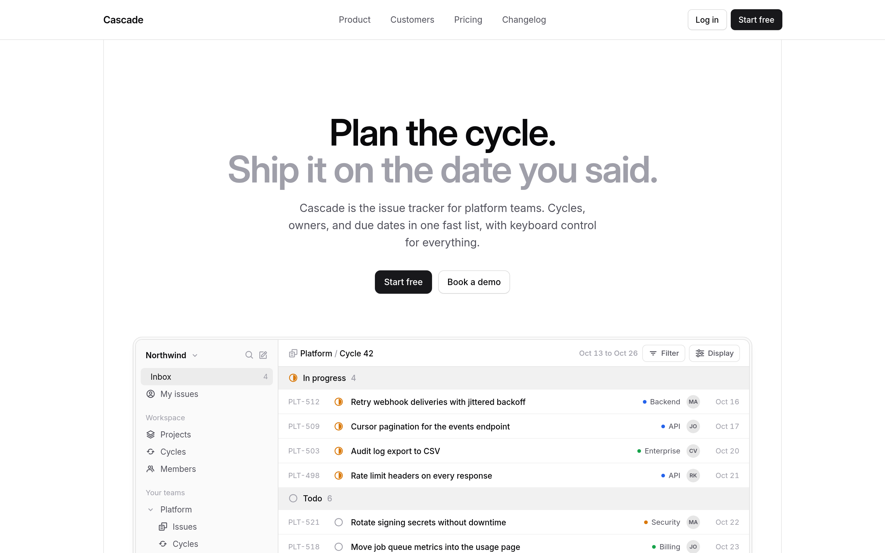

<p align="center">
  
</p>

<p align="center">A design skill for coding agents. Calm, product-first interfaces from landing page to app.</p>

## Install

```bash
npx skills add https://github.com/ChloeVPin/quiet --skill quiet
```

Or copy `skills/quiet/` into your agent skills directory.

## What it does

Quiet gives an agent a fixed taste and the numbers to hold it: one grotesk type scale, near-monochrome tokens, a 1104px grid on visible rails, real product UI in the fold, 32 and 36px controls, 40px table rows, and motion under 300ms. It bans the usual tells: gradients, glass, emoji icons, pill labels, stat-card heroes, serif headlines and placeholder copy.

The agent plans first, waits for approval, builds one surface per pass and checks itself against a rubric. Rules live in [`skills/quiet/SKILL.md`](skills/quiet/SKILL.md) and [`skills/quiet/references/`](skills/quiet/references/).

```bash
node skills/quiet/scripts/lint.mjs path/to/ui
```

## Examples

Every screen below was built by an agent following the skill. Each folder has the HTML and 2x screenshots.

<table>
  <tr>
    <td width="50%" valign="top">
      <picture><source media="(prefers-color-scheme: dark)" srcset="examples/saas/after-dark-fold.png" /></picture><br/>
      <a href="examples/saas/">SaaS landing</a>
    </td>
    <td width="50%" valign="top">
      <br/>
      <a href="examples/analytics/">Analytics</a>
    </td>
  </tr>
  <tr>
    <td width="50%" valign="top">
      <br/>
      <a href="examples/chat/">Chat</a>
    </td>
    <td width="50%" valign="top">
      <br/>
      <a href="examples/settings/">Settings</a>
    </td>
  </tr>
  <tr>
    <td width="50%" valign="top">
      <br/>
      <a href="examples/docs/">Docs</a>
    </td>
    <td width="50%" valign="top">
      <br/>
      <a href="examples/pricing/">Pricing</a>
    </td>
  </tr>
  <tr>
    <td width="50%" valign="top">
      <br/>
      <a href="examples/signin/">Sign in</a>
    </td>
    <td width="50%" valign="top">
      <br/>
      <a href="examples/changelog/">Changelog</a>
    </td>
  </tr>
  <tr>
    <td width="50%" valign="top">
      <br/>
      <a href="examples/devtool/">API landing</a>
    </td>
    <td width="50%" valign="top">
      <br/>
      <a href="examples/ecommerce/">Product page</a>
    </td>
  </tr>
  <tr>
    <td width="50%" valign="top">
      <br/>
      <a href="examples/waitlist/">Waitlist</a>
    </td>
    <td width="50%" valign="top">
      <br/>
      <a href="examples/agency/">Studio</a>
    </td>
  </tr>
  <tr>
    <td width="50%" valign="top">
      <br/>
      <a href="examples/empty/">404 and empty state</a>
    </td>
    <td width="50%" valign="top">
      <br/>
      <a href="examples/messy-landing/">Redesign: before</a>
    </td>
  </tr>
  <tr>
    <td width="50%" valign="top">
      <br/>
      <a href="examples/messy-landing/">Redesign: after</a>
    </td>
    <td width="50%" valign="top">
      &nbsp;&nbsp;<br/>
      <a href="examples/mobile/">Mobile home</a> and <a href="examples/mobile-onboard/">paywall</a>
    </td>
  </tr>
</table>

## License

MIT © Chloe Valesquez
