<p align="center">
  <picture>
    <source media="(prefers-color-scheme: dark)" srcset="assets/quiet-hero-dark.png" />
    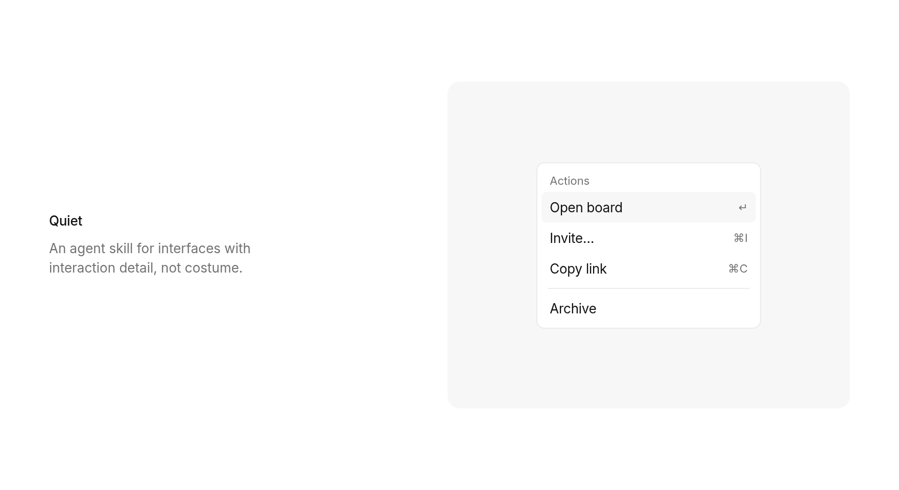
  </picture>
</p>

Quiet is an agent skill for UI that feels like Rauno, Paco, and Emil: small grotesk type, narrow layouts, real components, almost no costume.

Landing pages and product UI. Chat, sidebars, settings, dashboards.

## Install

```bash
npx skills add https://github.com/ChloeVPin/quiet --skill quiet
```

Or copy `skills/quiet/` into your agent skills directory.

## Before / after

Same NovaBoard. Different judgment.

<p align="center">
  
</p>

<p align="center">
  <picture>
    <source media="(prefers-color-scheme: dark)" srcset="assets/hero-dark.png" />
    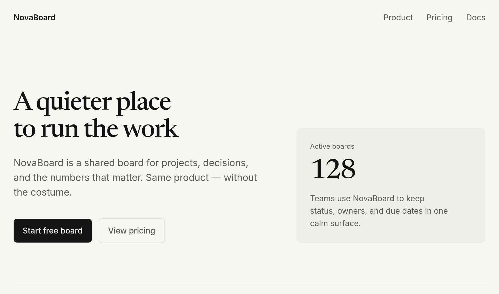
  </picture>
</p>

Full pages in [`examples/messy-landing/`](examples/messy-landing/).

## Rules that matter

One grotesk, about 14px. Near-monochrome. Strict 4px spacing and concentric radii. Product motion under 300ms, ease-out, interruptible, none on keyboard paths. Buttons name the action. No gradients, glass, emoji icons, stat-card heroes, hairline feature tables, corner version labels, or em dashes.

Encode taste. Plan. Wait for OK. One surface per pass. Check the rubric.

Details live in `skills/quiet/SKILL.md` and `skills/quiet/references/`.

```bash
node skills/quiet/scripts/lint.mjs path/to/ui
```

## SaaS landing

A noisy product page restyled as calm SaaS. Real board UI in the hero, one primary CTA, pricing without costume.

<p align="center">
  
</p>

<p align="center">
  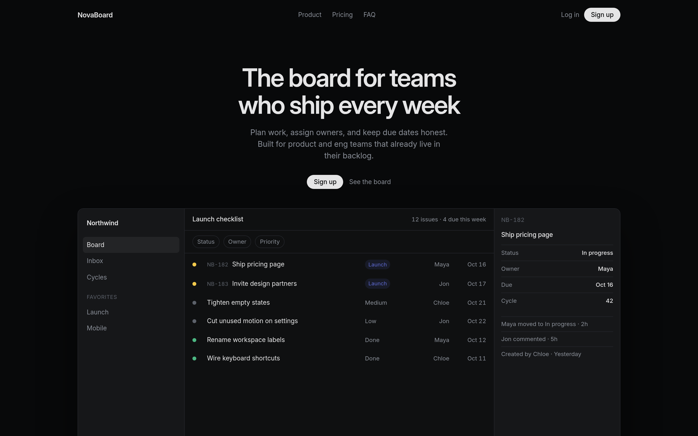
</p>

Full pages in [`examples/saas/`](examples/saas/).

## Examples

Surfaces beyond the landing pass. Each folder has before, after, and fold shots.

<table>
  <tr>
    <td align="center" width="50%">
      <a href="examples/analytics/"><strong>Analytics</strong></a><br/>
      
    </td>
    <td align="center" width="50%">
      <a href="examples/settings/"><strong>Settings</strong></a><br/>
      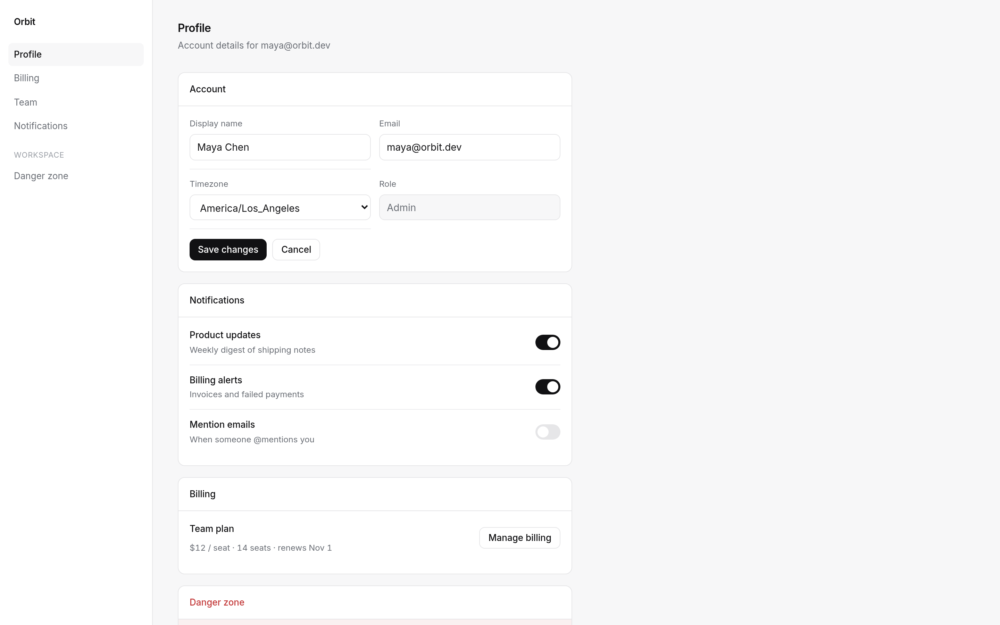
    </td>
  </tr>
  <tr>
    <td align="center" width="50%">
      <a href="examples/pricing/"><strong>Pricing</strong></a><br/>
      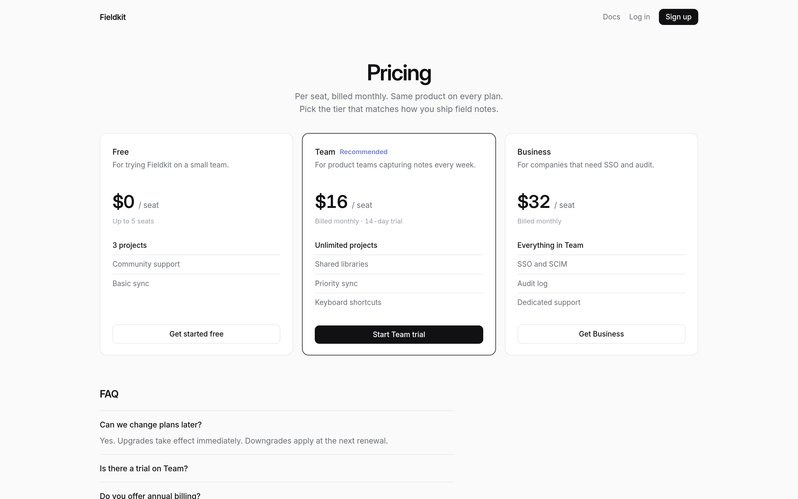
    </td>
    <td align="center" width="50%">
      <a href="examples/docs/"><strong>Docs</strong></a><br/>
      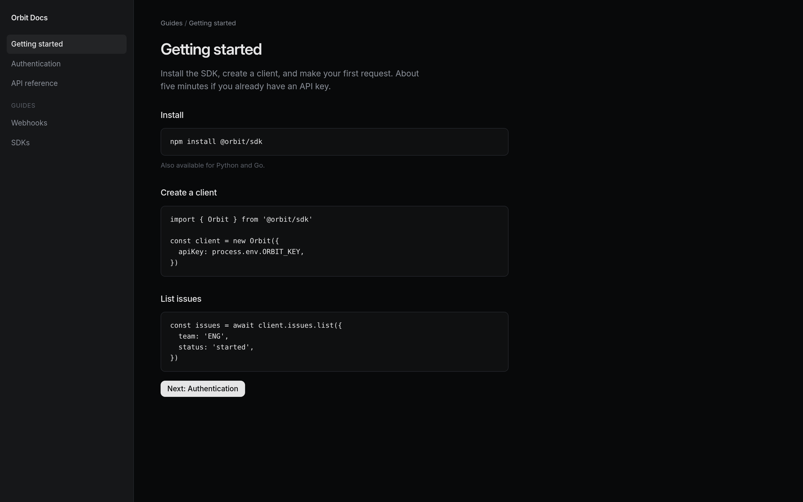
    </td>
  </tr>
  <tr>
    <td align="center" width="50%">
      <a href="examples/changelog/"><strong>Changelog</strong></a><br/>
      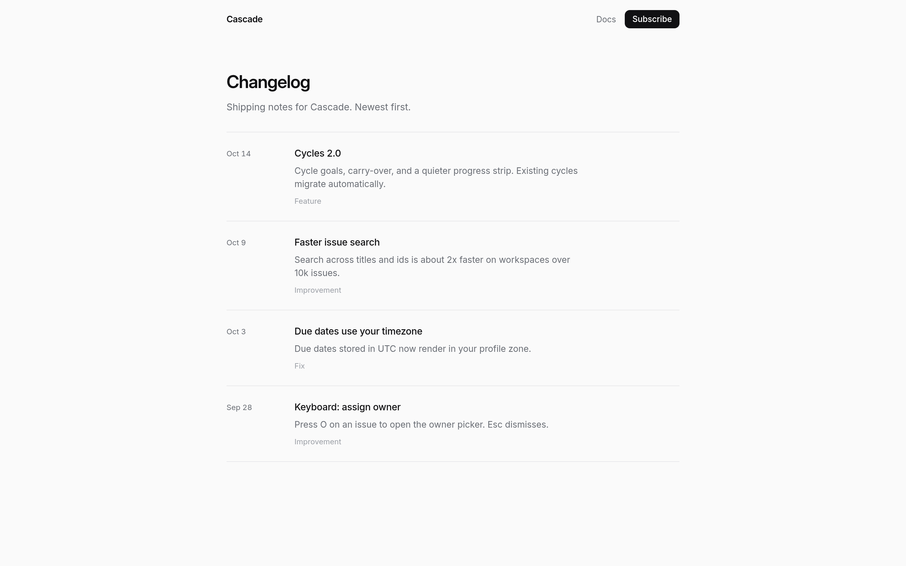
    </td>
    <td align="center" width="50%">
      <a href="examples/devtool/"><strong>API landing</strong></a><br/>
      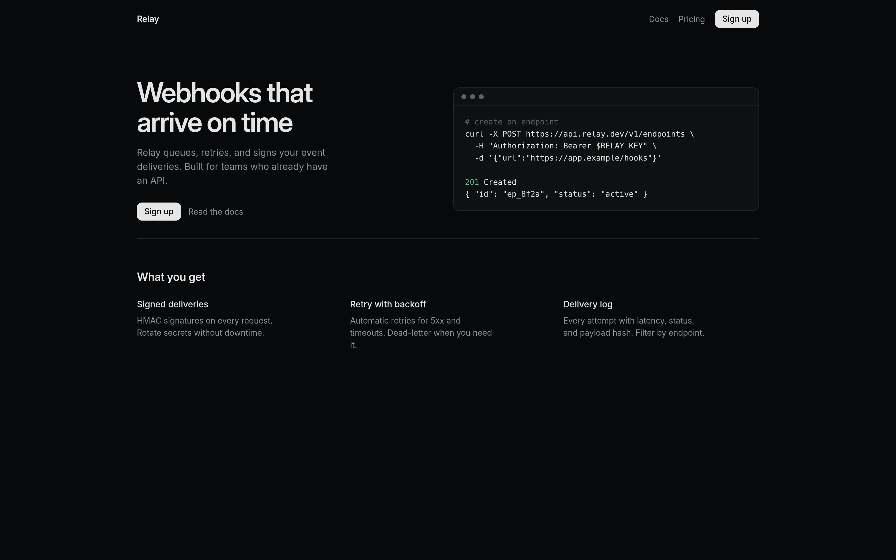
    </td>
  </tr>
  <tr>
    <td align="center" width="50%">
      <a href="examples/ecommerce/"><strong>E-commerce</strong></a><br/>
      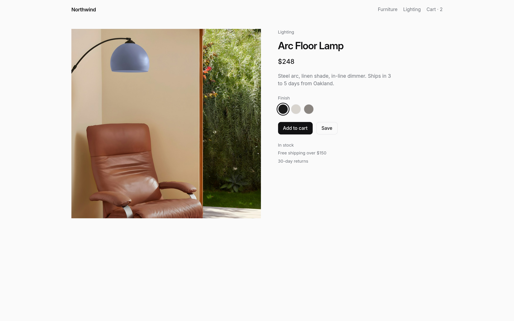
    </td>
    <td align="center" width="50%">
      <a href="examples/signin/"><strong>Sign-in</strong></a><br/>
      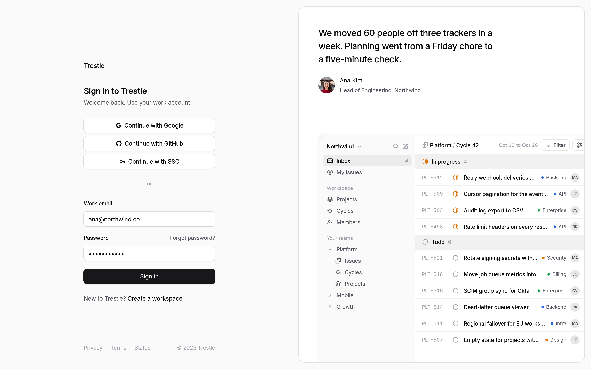
    </td>
  </tr>
  <tr>
    <td align="center" width="50%">
      <a href="examples/chat/"><strong>Chat</strong></a><br/>
      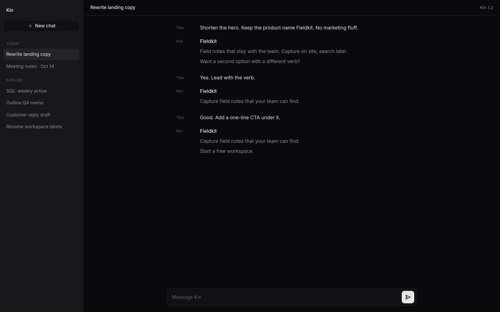
    </td>
    <td align="center" width="50%">
      <a href="examples/empty/"><strong>404</strong></a><br/>
      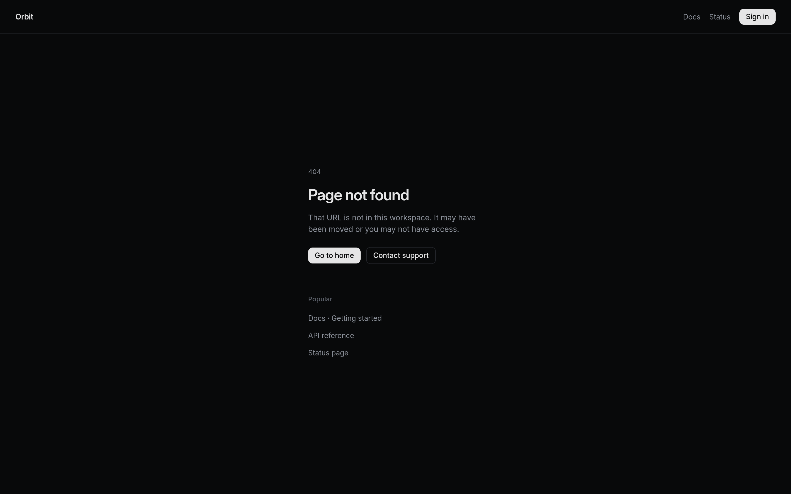
    </td>
  </tr>
  <tr>
    <td align="center" width="50%">
      <a href="examples/waitlist/"><strong>Waitlist</strong></a><br/>
      
    </td>
    <td align="center" width="50%">
      <a href="examples/agency/"><strong>Studio</strong></a><br/>
      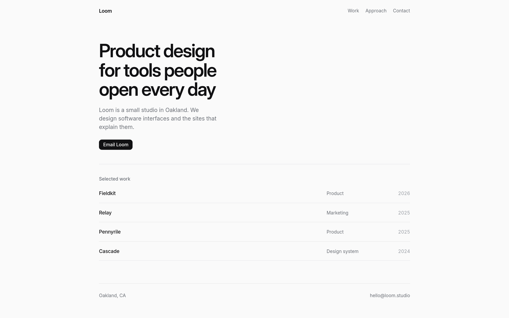
    </td>
  </tr>
  <tr>
    <td align="center" width="50%">
      <a href="examples/mobile/"><strong>Mobile home</strong></a><br/>
      
    </td>
    <td align="center" width="50%">
      <a href="examples/mobile-onboard/"><strong>Mobile paywall</strong></a><br/>
      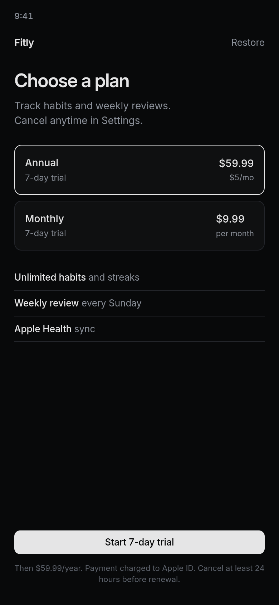
    </td>
  </tr>
</table>

Also [`examples/messy-landing/`](examples/messy-landing/) and [`examples/saas/`](examples/saas/).

## Credits

Primary: [rauno.me](https://rauno.me), [devouringdetails.com](https://devouringdetails.com), [paco.me/craft](https://paco.me/craft). Also Emil Kowalski, Jakub Krehel, Linear Method and Quality. Sources: [`skills/quiet/references/sources.md`](skills/quiet/references/sources.md). Not affiliated.

## License

MIT © Chloe Valesquez
