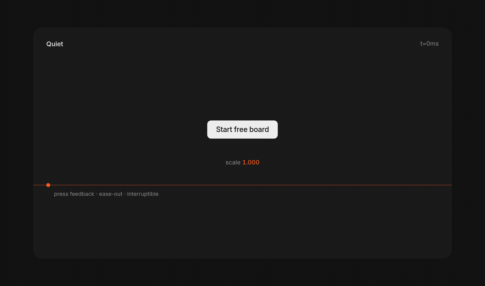

<p align="center">
  <picture>
    <source media="(prefers-color-scheme: dark)" srcset="assets/quiet-hero-dark.png" />
    
  </picture>
</p>

Quiet is an agent skill for UI where **interaction is the art**: the Rauno / Devouring Details tradition. Magnified details, tactile motion, components as specimens. Not costume.

Landing pages and product UI.

## Install

```bash
npx skills add https://github.com/ChloeVPin/quiet --skill quiet
```

Or copy `skills/quiet/` into your agent skills directory.

## Press

A Quiet control keeps mass. Scale to 0.97 over ~120ms, ease-out, interruptible. Never `scale(0)`.

<p align="center">
  
</p>

## Before / after

Same NovaBoard. Different judgment.

<p align="center">
  
</p>

<p align="center">
  <picture>
    <source media="(prefers-color-scheme: dark)" srcset="assets/hero-dark.png" />
    
  </picture>
</p>

Full pages in [`examples/messy-landing/`](examples/messy-landing/).

## Rules that matter

Treat the interface like a specimen. One grotesk, about 14px. Near-monochrome, one craft accent at most (for measurement, not decoration). Concentric radii you can prove in math. Product motion under 300ms. Buttons name the action. Prefer a live component over a slogan.

No gradients, glass, emoji icons, stat-card heroes, hairline feature tables, corner version labels, or em dashes.

Encode taste. Plan. Wait for OK. One surface per pass.

```bash
node skills/quiet/scripts/lint.mjs path/to/ui
```

## Credits

Primary: [rauno.me](https://rauno.me), [rauno.me/craft](https://rauno.me/craft), [devouringdetails.com](https://devouringdetails.com). Also Paco Coursey, Emil Kowalski, Jakub Krehel, Linear. Sources: [`skills/quiet/references/sources.md`](skills/quiet/references/sources.md).

## License

MIT © Chloe Valesquez
